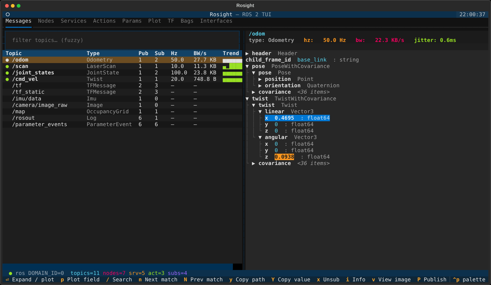
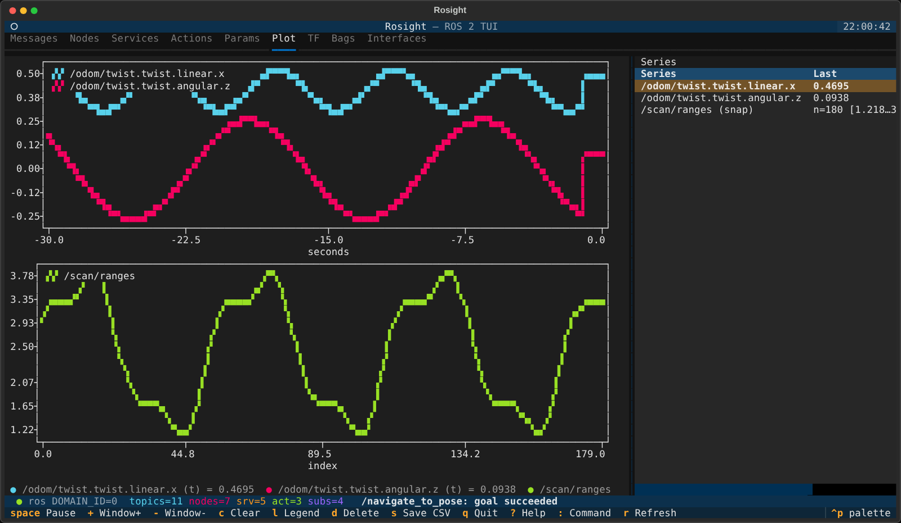
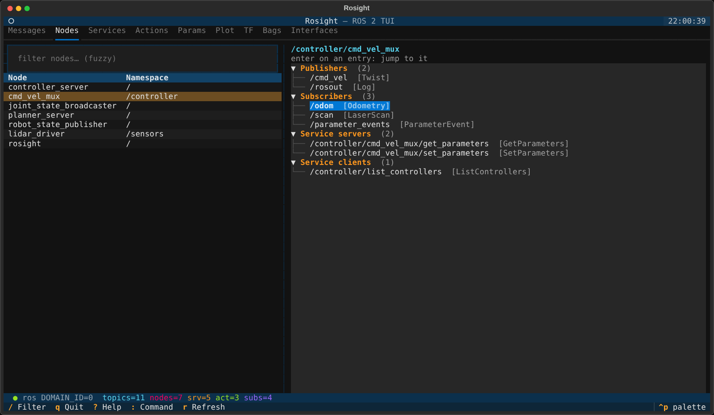
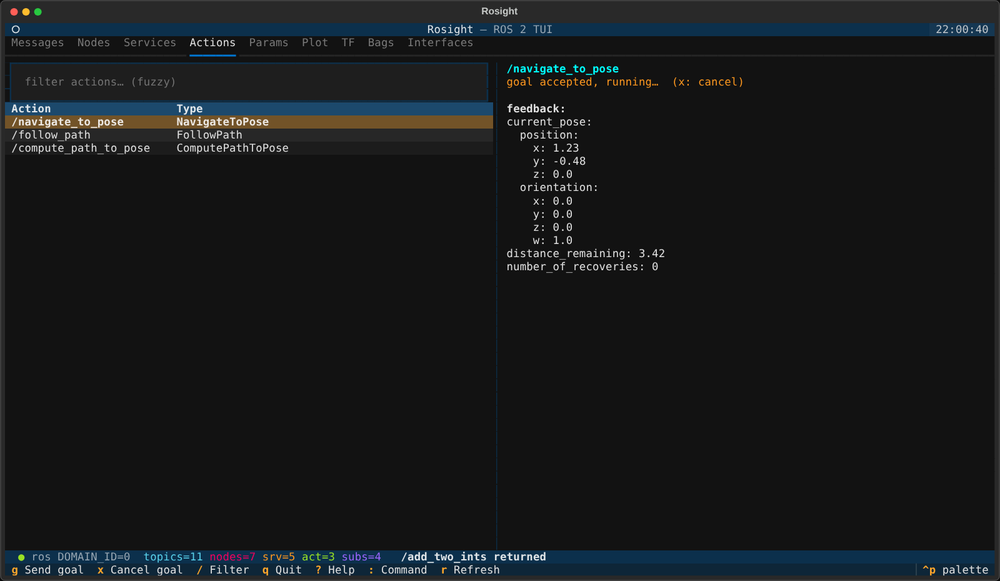
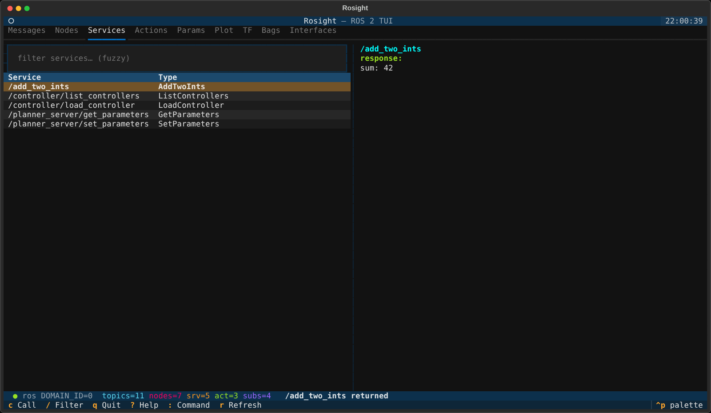
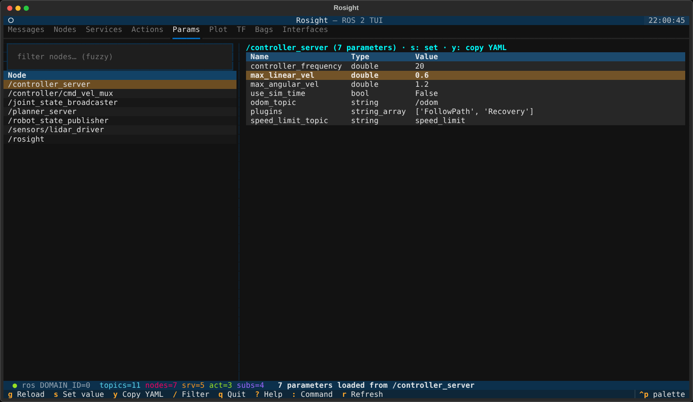
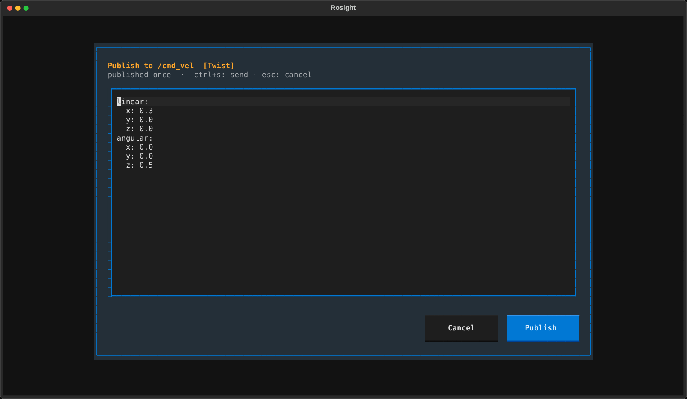
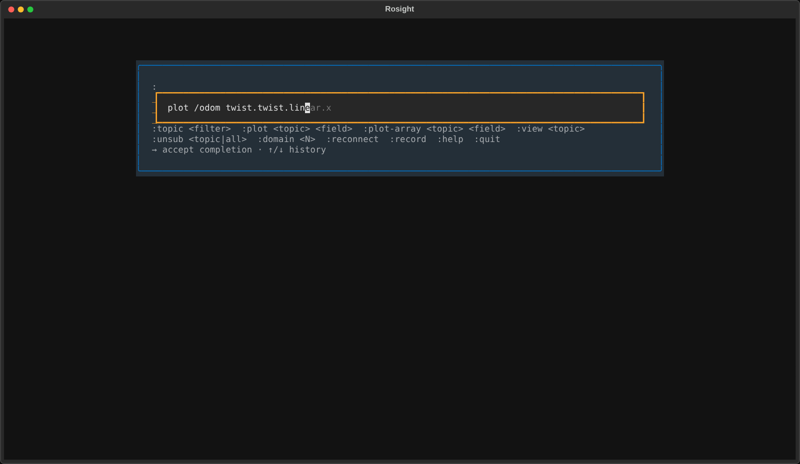
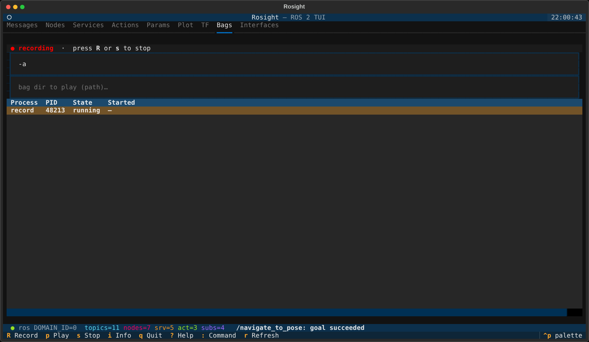

<p align="center">
  
</p>

# Rosight

[](https://pypi.org/project/rosight/)
[](https://pypi.org/project/rosight/)
[](https://pepy.tech/project/rosight)
[](https://github.com/deyuf/rosight/actions/workflows/ci.yml)
[](https://deyuf.github.io/rosight/)
[](LICENSE)

> **Rosight** = ROS + sight. A keyboard-driven terminal cockpit for ROS 2.

Browse the live ROS 2 graph — messages, nodes, services, actions, parameters,
TF, bags, interfaces — and live-plot any numeric field, all from one screen
without a mouse. Built for SSH, tmux, robot consoles.

📖 **Docs:** <https://deyuf.github.io/rosight/>


*Messages — subscribed topics with Hz / bandwidth / trend; the message tree highlights values as they change*

## What's inside

Nine tabs, keyboard-driven, all on one screen:

| `#` | Tab | What you can do |
|---|---|---|
| `1` | **Messages** | Fuzzy-filter the topic table (● marks subscribed topics; Hz, bandwidth and an Hz trend sparkline per topic). `Enter` subscribes, `x` unsubscribes. The message tree highlights values as they change; `/` searches fields, `y` / `Y` copy a path / value. `Space` pauses and `[` / `]` step through the last 100 messages. `P` publishes from a YAML form, `i` shows publisher QoS, `v` previews `Image` / `CompressedImage` topics. |
| `2` | **Nodes** | Every node with its publishers, subscribers and service endpoints as a tree — `Enter` on an entry jumps to that topic or service. |
| `3` | **Services** | `c` calls a service from a YAML request form (pre-filled, remembers your last request) and shows the response. |
| `4` | **Actions** | `g` sends a goal from a YAML form with live feedback and final status / result; `x` cancels. |
| `5` | **Params** | Per-node parameters. `s` sets a value (type-checked, arrays included), `y` copies all of them as a ROS 2 params file. |
| `6` | **Plot** | Multi-series live plot — scalar time-series **and** 1D-array snapshots (e.g. LaserScan `ranges`). Add fields with `p` / `Enter` in the message tree without leaving it. Pause, window scaling, CSV export. |
| `7` | **TF** | Auto-built frame tree from `/tf` and `/tf_static`. |
| `8` | **Bags** | `ros2 bag record` / `play` / `info`. Recorders are stopped gracefully (bag finalized) and never outlive the app. |
| `9` | **Interfaces** | Browse `msg` / `srv` / `action` definitions of every interface package on the system. |

Image rendering uses the terminal's native graphics protocol when
available (kitty / sixel / iTerm2) and falls back to Unicode half-blocks
otherwise — see [docs/plotting.md](docs/plotting.md#images-rgb-depth-compressed)
for the support matrix.

### Screenshots

<table>
<tr>
<td width="50%"><br/><em>Plot — time-series and a LaserScan snapshot</em></td>
<td width="50%"><br/><em>Nodes — enter on an endpoint jumps to it</em></td>
</tr>
<tr>
<td><br/><em>Actions — goal running with live feedback</em></td>
<td><br/><em>Services — call result</em></td>
</tr>
<tr>
<td><br/><em>Params — s: set · y: copy as params YAML</em></td>
<td><br/><em>Publish / call / goal forms are YAML</em></td>
</tr>
<tr>
<td><br/><em>Command palette — completes topics and field paths</em></td>
<td><br/><em>Bags — recording state</em></td>
</tr>
</table>

Cross-cutting features:

- **Auto-QoS** — the subscriber profile is negotiated to match every publisher (BEST_EFFORT vs RELIABLE, TRANSIENT_LOCAL, …), so sensor topics "just work". If a publisher is still incompatible, the topic says so (`QoS!`) instead of silently showing 0 Hz.
- **Cheap on busy graphs** — subscriptions receive raw bytes and decode only what is on screen; the graph is discovered once per second on a background thread, never on the UI loop.
- **Remembers your session** — theme, last tab, filters, plot series and command history are restored on the next start (`state.toml`, next to your config).
- **Fast navigation** — fuzzy filters everywhere, `:` palette with completion and history, `j` / `k` / `g` / `G` motions, node → topic jumps.
- **Runtime domain switch** — `:domain 5` reconnects on a new `ROS_DOMAIN_ID` without restarting; `:reconnect` restarts the backend if its executor ever stops (the status bar turns red).
- **No ROS required for the UI** — the package imports cleanly without `rclpy`, so you can dev / unit-test on cloud machines. Run with `--no-ros` to stay offline.

## Install

From PyPI:

```bash
pip install rosight
```

Then, in any terminal where you want to use it:

```bash
source /opt/ros/<distro>/setup.bash
rosight
```

If you maintain multiple distros, source the one whose `rclpy` should drive
discovery before launching. See the
[installation guide](https://deyuf.github.io/rosight/installation/) for the
recommended `--system-site-packages` venv layout that keeps the system `rclpy`
reachable while pip manages everything else.

From source (for development):

```bash
git clone https://github.com/deyuf/rosight
cd rosight
pip install -e ".[dev]"
```

## Quick start

```bash
# launch (inherits ROS_DOMAIN_ID from env)
rosight

# pick a domain explicitly + log to file
rosight --domain-id 5 --log-file /tmp/rosight.log

# UI-only mode, no rclpy needed (great for theme / layout dev)
rosight --no-ros
```

Inside the app:

- `?` — keyboard reference overlay
- `:` — command palette with completion (`topic <filter>`, `plot <topic> <field>`, `node <name>`, `param <node>`, `unsub <topic|all>`, `domain <N>`, `reconnect`, `quit`)
- `1`–`9` — jump to a tab
- `/` — fuzzy-filter the current panel
- `q` or `Ctrl+C` — quit (asks first while a bag is recording)
- `r` — rediscover the ROS graph now

Plotting workflow (the question new users ask most):

1. **Messages tab**, cursor over a topic, **Enter** to subscribe (focus auto-jumps to the message tree)
2. Use arrow keys / Space to expand fields in the tree
3. Cursor on a *numeric* leaf (int / float), press **p** — the series is added and you stay in the tree, so you can add more
4. Press **6** for the Plot tab (or type `:plot /odom twist.twist.linear.x`, which adds and opens it)

## Documentation

Full docs site: <https://deyuf.github.io/rosight/>

| Topic | Page |
|-------|------|
| Installation per distro | [Install](https://deyuf.github.io/rosight/installation/) |
| Daily usage | [Usage](https://deyuf.github.io/rosight/usage/) |
| Keybindings | [Keybindings](https://deyuf.github.io/rosight/keybindings/) |
| Configuration | [Configuration](https://deyuf.github.io/rosight/configuration/) |
| Plotting deep-dive | [Plotting](https://deyuf.github.io/rosight/plotting/) |
| Architecture | [Architecture](https://deyuf.github.io/rosight/architecture/) |
| Contributing | [Development](https://deyuf.github.io/rosight/development/) |
| FAQ | [FAQ](https://deyuf.github.io/rosight/faq/) |

## Project layout

```
src/rosight/
├── app.py             # Textual App, panel registry, global keys, palette commands, state
├── cli.py             # argparse entry point
├── config.py          # TOML config loader + state.toml persistence
├── ros/
│   ├── backend.py     # rclpy facade: lifecycle, raw subscriptions, publish,
│   │                  # services, parameters, action goals, executor health
│   ├── discovery.py   # GraphMonitor thread + GraphSnapshot
│   ├── introspection.py  # dynamic message-type resolution, field walking
│   ├── yaml_msg.py    # message <-> YAML for the forms
│   ├── qos.py         # plain-data QoS + auto-negotiation
│   └── stats.py       # hz / bw monitors
├── utils/
│   ├── datatable.py   # incremental table sync + last-column auto-fit
│   ├── fuzzy.py       # fuzzy filter
│   ├── ringbuffer.py  # thread-safe bounded buffers
│   ├── path.py        # message field-path parser
│   └── formatting.py  # display helpers, sparklines
└── widgets/           # one file per panel, GraphListPanel base (_base.py),
                       # message tree, YAML form, palette, help, status bar
```

## Tech stack & rationale — short version

- **Python 3.10 (ROS 2 Humble) or 3.12 (Jazzy / Kilted)** + **rclpy** (first-class ROS 2 client, dynamic message introspection via `rosidl_runtime_py`)
- **Textual** (modern async TUI, CSS-like styling, headless pilot tests — that's how a 350-test suite stays meaningful for a TUI)
- **plotext 5** for ANSI plotting in the Plot tab
- **hatch + ruff + mypy + pytest-asyncio** for the dev loop
- **MkDocs Material** for the docs site
- rclpy runs on its own `SingleThreadedExecutor` thread with raw-bytes subscriptions, and graph discovery has a thread of its own, so the Textual loop never waits on DDS. See the [architecture page](docs/architecture.md) for the full reasoning.

## Status

Beta. Discovery, subscription, plotting, publish, service calls, action
goals, parameter editing, TF, bag record / play, state persistence and
runtime domain switch all work, tested headless and against real rclpy on
Humble and Jazzy in CI.

## License

MIT. See [`LICENSE`](LICENSE).
