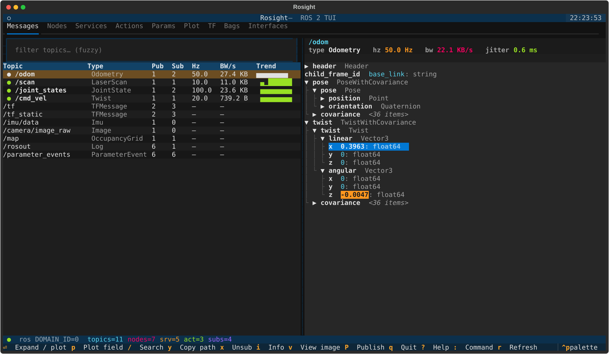
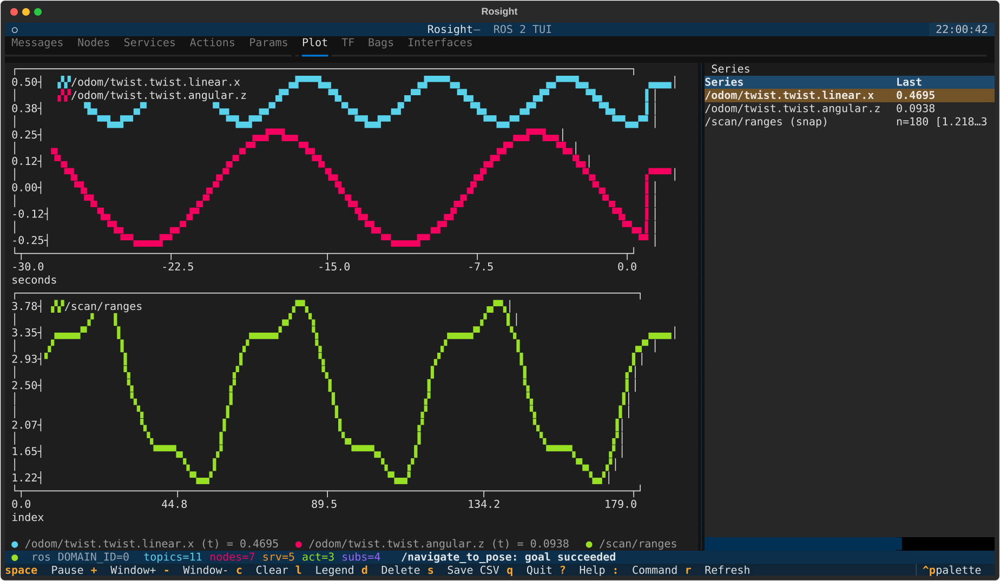
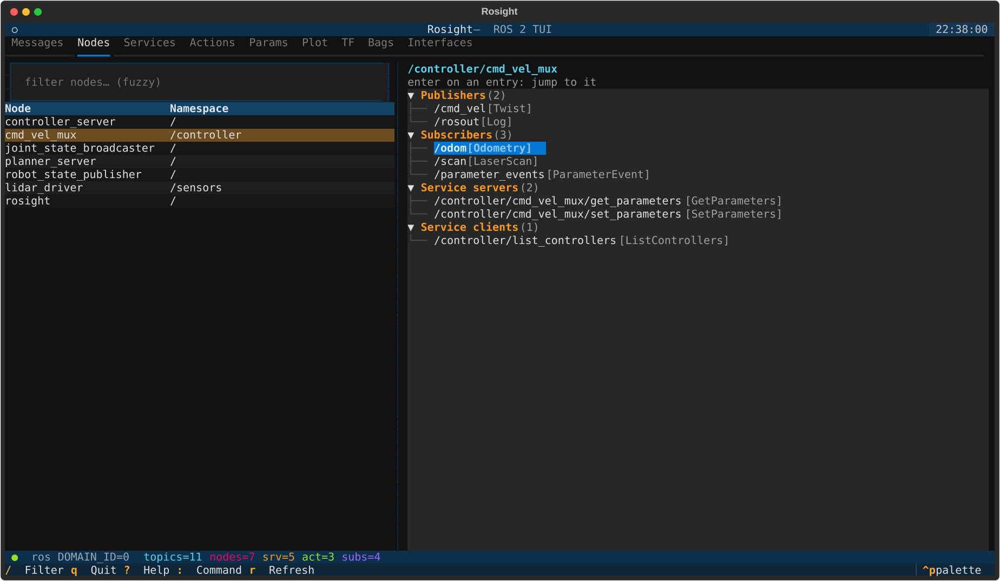
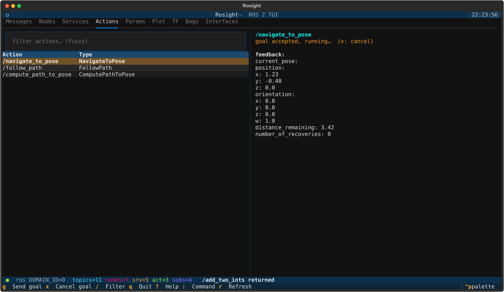
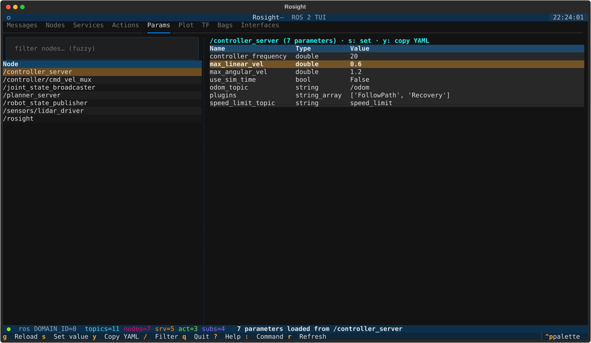
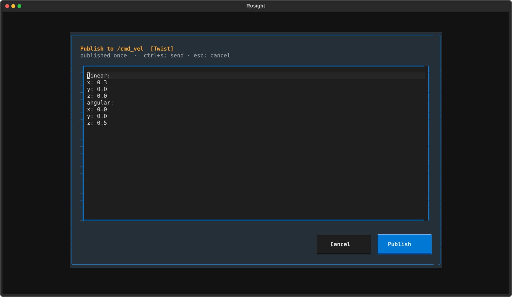
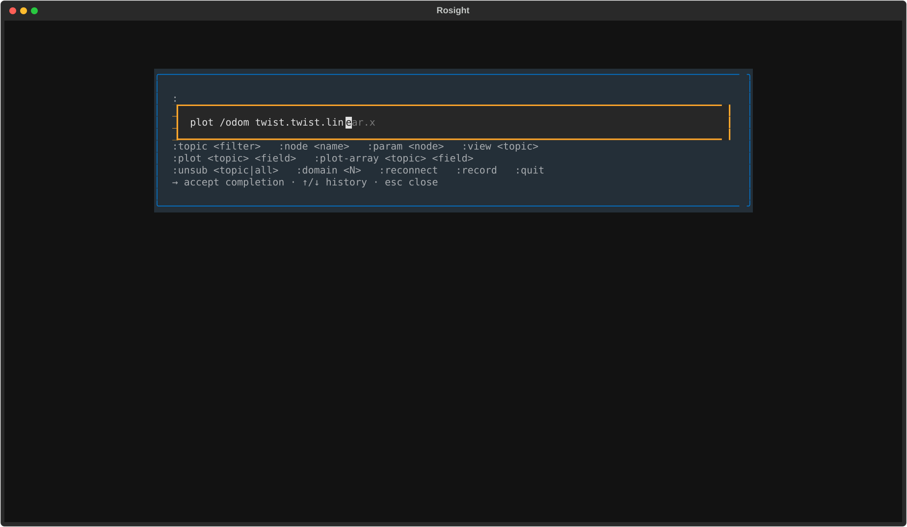

# Rosight

> **ROS + sight.** A keyboard-driven terminal cockpit for ROS 2.

Browse the live ROS 2 graph — messages, nodes, services, actions, parameters,
TF, bags, interfaces — and live-plot any numeric field, all from one screen
without a mouse. Built for SSH, tmux, robot consoles.

## What's inside

Nine tabs, one screen, all keyboard:

- **Messages** — topic list with live Hz / bandwidth / trend, message tree that highlights changing values, field search and copy, paused history stepping, publish form, auto-QoS subscription.
- **Nodes** — publishers, subscribers and services per node; jump straight to any of them.
- **Services** — discovery + types, call from a YAML request form.
- **Actions** — discovery + types, send goals with live feedback and cancel.
- **Params** — per-node parameters, type-checked set, copy as a params file.
- **Plot** — multi-series live chart of any numeric field or numeric array via `plotext`.
- **TF** — auto-built frame tree from `/tf` and `/tf_static`.
- **Bags** — `ros2 bag record` / `play` / `info` with stop hints.
- **Interfaces** — browse every `msg` / `srv` / `action` definition on the system.

## Why Rosight

- **Runs anywhere a terminal does.** SSH, tmux, robot console, phone via Termius.
- **Auto-QoS.** Sensor topics (`BEST_EFFORT`, `TRANSIENT_LOCAL` …) are matched by negotiating against every publisher — no manual profile fiddling.
- **Cheap on busy graphs.** Subscriptions receive raw bytes and decode only what's on screen; discovery runs once per second on its own thread.
- **Runtime domain switch.** `:domain 5` reconnects on a new `ROS_DOMAIN_ID` without restarting; `:reconnect` if the executor ever stops.
- **Remembers your session.** Theme, last tab, filters, plot series and command history survive restarts.
- **Stable when ROS isn't there.** The package imports cleanly without `rclpy`, so you can run unit tests and tweak the UI on cloud hosts. Live panels light up the moment a workspace is sourced.

## Gallery

| | |
|---|---|
|  Plot |  Nodes |
|  Action goal with feedback |  Params |
|  YAML publish form |  Palette completion |

## Next steps

- [Install](installation.md) on your distro
- Read the [usage guide](usage.md)
- Learn the [keybindings](keybindings.md) (incl. the `:` command palette)
- Tune the [configuration](configuration.md)
- Plotting workflow in [plotting](plotting.md)
- Skim the [architecture](architecture.md) before contributing
- [FAQ](faq.md) — text selection, "no series" hint, etc.
